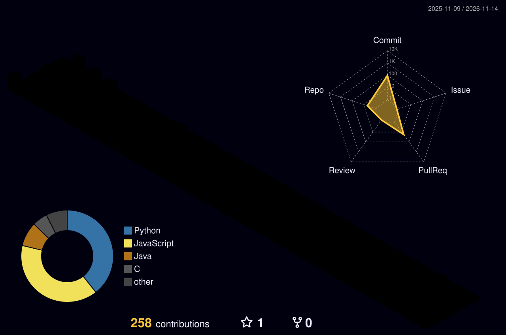

[Email](mailto:echiahachris@mun.ca) &nbsp;·&nbsp; [Projects](#-featured-projects) &nbsp;·&nbsp; [Stack](#-tech-stack) &nbsp;·&nbsp; [Contact](#-get-in-touch)

 

## 👋 About

I build full-stack web applications, from the database to the interface.

|  |  |
|---|---|
| 🎓 **Education** | B.Sc. in Computer Science, Memorial University of Newfoundland (Dec 2025) |
| 📍 **Location** | St. John's, Newfoundland and Labrador, Canada |
| 🌎 **Availability** | Remote across Canada, or relocating within Canada for the right role |

## 🎯 Open To

| Help Desk / IT Support | Software Development | Technical Analyst | Product Owner |
|:---:|:---:|:---:|:---:|
| Support and troubleshooting | Full-stack engineering | Requirements and data | Junior / Associate |

## 🚧 Currently Building

> **[Fraud Detection Platform](https://github.com/boop-dev/FraudDetectionSoftware)**: a real-time fraud detection system in Python. *In progress.*

## 🚀 Featured Projects

<table>
  <tr>
    <td width="50%" valign="top">
      <h3><a href="https://github.com/boop-dev/COMP4754-AppliedGroup2-Fall2025">Geology Database Management System</a></h3>
      
Full-stack app for managing geological data, with a dynamic query builder and real-time updates. Team project, Fall 2025.

      
   

      
<a href="https://comp4754-appliedgroup2-fall2025.onrender.com">Live demo →</a>

    </td>
    <td width="50%" valign="top">
      <h3><a href="https://github.com/boop-dev/Flavorea">FlavorRea</a></h3>
      
Recipe website with dynamic recipe search and category browsing.

      
  

      
<a href="https://flavorea.onrender.com">Live demo →</a>

    </td>
  </tr>
  <tr>
    <td width="50%" valign="top">
      <h3><a href="https://github.com/boop-dev/FraudDetectionSoftware">Fraud Detection Software</a></h3>
      
Real-time fraud detection platform. In progress.

      

    </td>
    <td width="50%" valign="top">
      <h3><a href="https://github.com/boop-dev/Game-Of-Life">Game of Life Simulator</a></h3>
      
Conway's Game of Life with cell initialization patterns and a graphical interface.

      
 

    </td>
  </tr>
</table>

## 🧰 Tech Stack

**Frontend** 

**Backend** 

**Database & Tools** 

## 📊 GitHub Activity

## 📬 Get in Touch

📞 709-219-4496

 

*"Talk is cheap. Show me the code."* — Linus Torvalds

