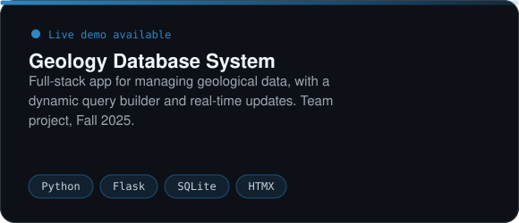
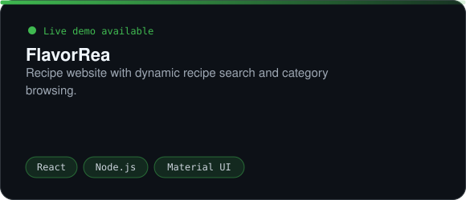
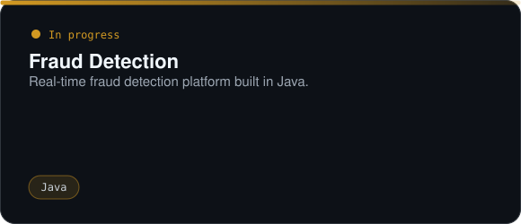
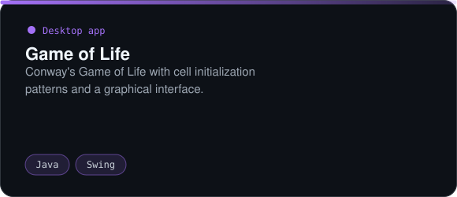

 

I build full-stack web applications, from the database to the interface. I graduated with a B.Sc. in Computer Science from Memorial University of Newfoundland in December 2025 and I'm based in St. John's, Newfoundland and Labrador.

I'm open to remote work across Canada, and to relocating within Canada for the right role.

<table>
<tr>
<td align="center" width="25%"><h3>🛟</h3><b>Help Desk IT Support</b></td>
<td align="center" width="25%"><h3>💻</h3><b>Software Development</b></td>
<td align="center" width="25%"><h3>📈</h3><b>Technical Analyst</b></td>
<td align="center" width="25%"><h3>🧭</h3><b>Product Owner Junior / Associate</b></td>
</tr>
</table>

**Live demos:** [Geology Database System](https://comp4754-appliedgroup2-fall2025.onrender.com) · [FlavorRea](https://flavorea.onrender.com)

Also: Material UI · HTMX · SQL

**[echiahachris@mun.ca](mailto:echiahachris@mun.ca)** · 709-219-4496 · [@boop-dev](https://github.com/boop-dev)

 

<i>"Talk is cheap. Show me the code."</i> — Linus Torvalds

